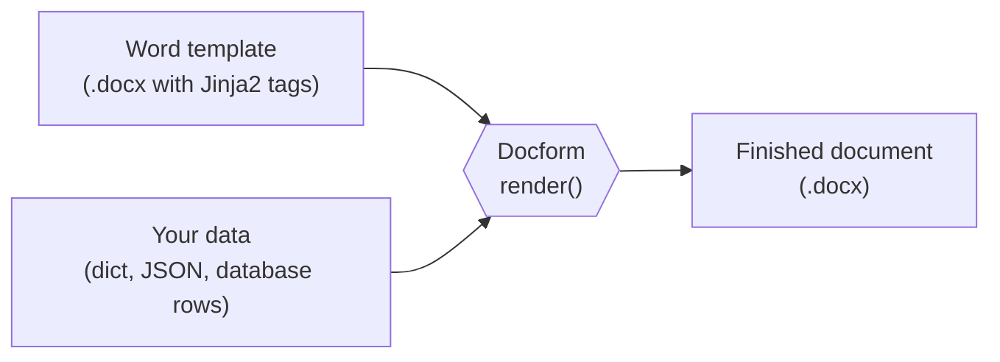
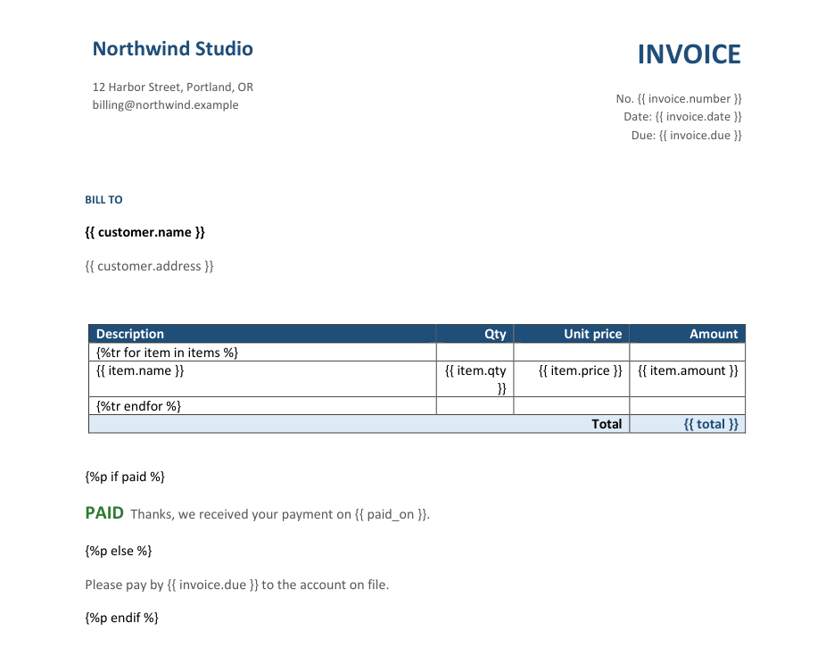
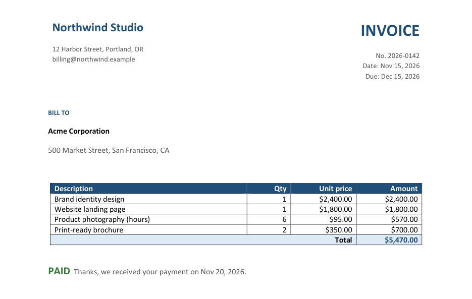

<div align="center">

# Docform

**Fill document templates with data.**

[](https://pypi.org/project/docform/)
[](https://pypi.org/project/docform/)
[](https://github.com/cvas22/docform/actions/workflows/tests.yml)
[](https://github.com/cvas22/docform/actions/workflows/codeql.yml)
[](LICENSE.txt)
[](https://pepy.tech/project/docform)

[Install](#install) · [Quickstart](#quickstart) · [Example](#example) · [Docs](docs/index.rst) · [Roadmap](ROADMAP.md) · [Contributing](CONTRIBUTING.md)

</div>

---

Design the document in Word with whatever layout, styles, headers and images you need, and put [Jinja2](https://jinja.palletsprojects.com/) tags where the data goes. Docform renders it into a finished `.docx`, so you can generate contracts, invoices, reports, certificates and letters in bulk from Python.

## Install

```bash
pip install docform

# with subdocument support
pip install "docform[subdoc]"
```

## Quickstart

In Word, write a template like this and save it as `invoice_template.docx`:

```text
Invoice for {{ customer }}


| {{ item.name }} | {{ item.qty }} |


Total: {{ total }}
```

Then render it:

```python
from docform import DocxTemplate

doc = DocxTemplate("invoice_template.docx")
doc.render({
    "customer": "Acme",
    "items": [{"name": "Widget", "qty": 3}, {"name": "Gadget", "qty": 1}],
    "total": "$120.00",
})
doc.save("invoice_acme.docx")
```

Everything you set up in Word, like fonts, logos and page layout, stays intact. Only the tags are replaced.

## How it works



## Example

This invoice comes from [`examples/invoice`](examples/invoice). The template on the left is a normal Word file. Running `python render.py` turns it into the document on the right.

<table>
  <tr>
    <th>Template (<code>invoice_template.docx</code>)</th>
    <th>Rendered (<code>invoice_acme.docx</code>)</th>
  </tr>
  <tr>
    <td></td>
    <td></td>
  </tr>
</table>

A few things to notice in the template:

- `` and `` sit in their own table rows. Docform repeats the row between them once per item and removes the tag rows.
- `` works the same way for paragraphs, so the payment note switches between "PAID" and a reminder.
- Formatting on a tag, like the bold blue `{{ total }}`, carries over to the value.

## Features

- Full Jinja2 syntax: variables, conditions, loops, filters and custom filters
- Paragraph, table row, table cell and run level tags (``, ``, ``, ``) that remove the surrounding Word element so loops don't leave empty rows behind
- Rich text with colors, fonts, bold, italic, links and right-to-left text
- Inline images, plus replacing pictures and embedded objects already in the template
- Subdocuments: build parts with python-docx or merge in existing `.docx` files
- Headers, footers, footnotes and document properties
- Cell background colors and horizontal and vertical cell merges
- Listing undeclared template variables before rendering
- A command line interface for JSON-driven rendering

## Command line

```bash
python -m docform template.docx data.json output.docx
```

Use `-o` to overwrite an existing output file and `-q` for quiet mode.

## Sandboxed rendering

Templates run Jinja2 code, so by default Docform renders them in Jinja2's `SandboxedEnvironment`. Normal template features work, but a template can't reach Python internals like `__globals__` or `__class__`, and trying raises `jinja2.exceptions.SecurityError`.

If you pass your own `jinja_env`, Docform uses it as is. Use a `SandboxedEnvironment` there too unless every template is trusted:

```python
from jinja2.sandbox import SandboxedEnvironment

env = SandboxedEnvironment(autoescape=True)
env.filters["shout"] = str.upper
doc.render(context, jinja_env=env)
```

To turn the sandbox off for templates you fully trust, pass `jinja_env=jinja2.Environment()`, or `--unsafe` on the command line.

## Formats

Word (`.docx`) is the only format today. Each format lives in its own module, so new ones can be added without breaking existing code:

```python
from docform.docx import Template
```

## Documentation

The full template syntax and API reference are in [`docs/`](docs/index.rst). [`examples/`](examples/) has complete, runnable examples, and [`tests/`](tests/) has a small script for every feature.

## Roadmap

Next up are the stuck fixes from python-docx-template, type hints and safer defaults for untrusted templates, and later Excel and PowerPoint support. See [ROADMAP.md](ROADMAP.md).

## Contributing

Bug reports, fixes and features are welcome. [CONTRIBUTING.md](CONTRIBUTING.md) covers setup, tests and how to send a pull request, and everyone taking part follows the [code of conduct](CODE_OF_CONDUCT.md). Please report security problems privately as described in [SECURITY.md](SECURITY.md).

## Adopters

Using Docform in production or in an open source project? Add yourself to [ADOPTERS.md](ADOPTERS.md).

## Citing

If you use Docform in research, please cite it. GitHub's "Cite this repository" button reads [CITATION.cff](CITATION.cff).

## Maintainer

Docform is maintained by [Srinivas Chippagiri](https://github.com/cvas22).

## Credits

Docform builds on [python-docx](https://github.com/python-openxml/python-docx) and [Jinja2](https://github.com/pallets/jinja).

## License

[LGPL-2.1](LICENSE.txt).

---

<div align="center">
If Docform saves you time, a star on GitHub helps others find it.
</div>
